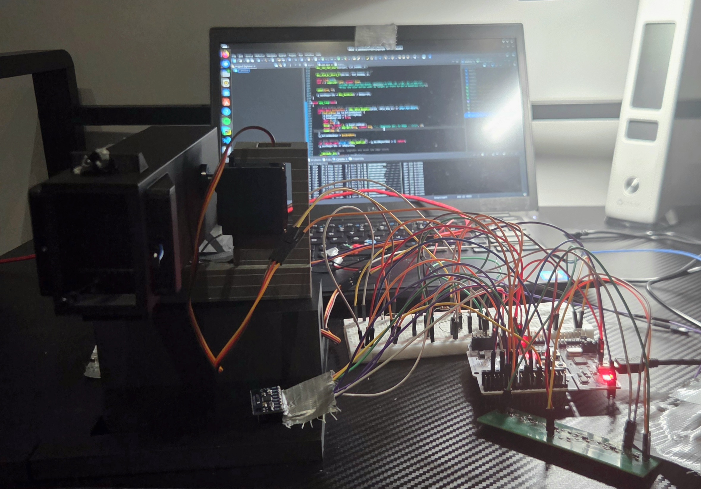
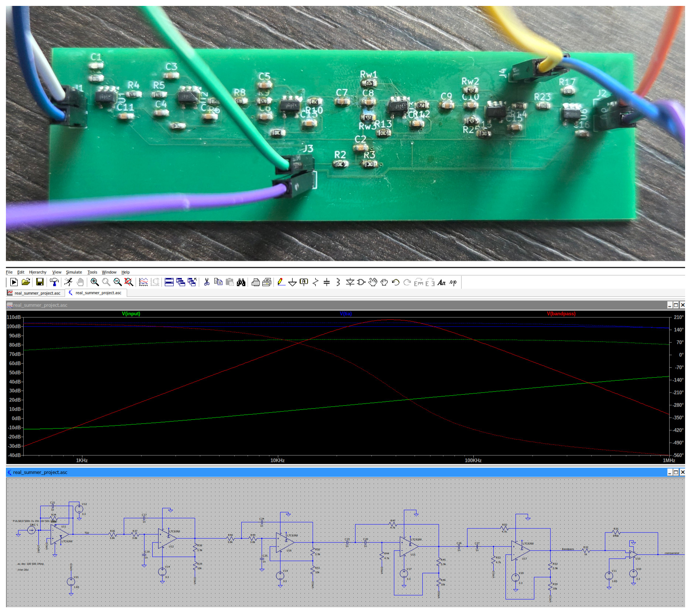

# Electro-Optical Tracking System

A 4-channel infrared target-tracking system on a 2-axis pan-tilt gimbal, built from the analog front end up: custom photodiode PCBs, mixed-signal hardware design, real-time C++ firmware on an STM32F4, and closed-loop PID control. Designed and built independently, June – September 2026.

## Overview

The target carries an IR emitter modulated at 38 kHz. Four photodiode channels detect the signal, and each channel is amplified, bandpass-filtered and digitised. The STM32 compares the four channel intensities to calculate the target's angular error. A dual-axis PID loop with IMU feed-forward then drives the pan and tilt servos to keep the target centred.

**Signal chain**

Photodiode → Transimpedance amplifier → Cascaded Sallen-Key bandpass (38 kHz) → LM393 Schmitt trigger / ADC → STM32F4 (DMA) → PID controller → Servos

## Hardware

### Analog Front End
- Transimpedance amplifier on each channel, converting photodiode current to voltage
- Cascaded Sallen-Key bandpass filters centred on 38 kHz, rejecting ambient light and low-frequency interference so only the modulated target signal passes
- Full front end designed and verified in LTspice before layout

### Target Discrimination
- LM393 comparator configured as a Schmitt trigger, with hysteresis to prevent noise-induced chatter around the detection threshold

### PCB Design
- Custom photodiode boards replacing the original breadboard prototype
- Mixed-signal layout in KiCad 7, keeping sensitive analog sections separated from digital circuitry
- Fabricated by JLCPCB, then assembled and tested

## Firmware

Written in C++ for an STM32F4 Nucleo board:
- DMA-driven ADC sampling of all four channels, offloading data transfer from the CPU
- Hardware timer interrupts providing a fixed-rate, deterministic control loop
- Dual-axis PID control for pan and tilt
- IMU feed-forward to compensate for motion of the base

## Mechanical Design

- 2-axis pan-tilt gimbal designed in Fusion 360, driven by servos on each axis

## Testing & Validation

- Software-in-the-loop simulation of the control loop before hardware testing
- Regression test suite for firmware modules
- PID tuning and closed-loop validation on the assembled system

## Design Logbook

The full design logbook covers circuit simulation, PCB layout decisions, firmware architecture, PID tuning and test results will be uploaded shortly when formtting is complete.

## Tools & Technologies

LTspice · KiCad 7 · C++ · STM32F4 · Fusion 360
